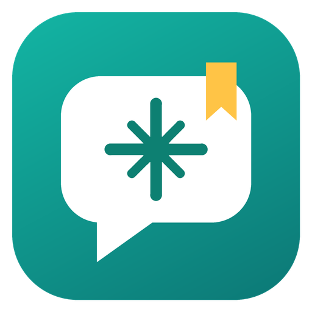

<h1 align="center">Chatkeep</h1>

<b>Back up, browse and search every Claude conversation. Free.</b>

  <a href="https://badnorouz.github.io/chatkeep/"><b>Website</b></a> ·
  <a href="https://github.com/badnorouz/chatkeep/releases/latest"><b>Download</b></a> ·
  <a href="PRIVACY.md">Privacy</a> ·
  <a href="LICENSE.txt">License</a>

Chatkeep is a **free** desktop app that keeps your **Claude Code**, **Cowork** and **claude.ai** chats safe on your own computer — and lets you search every word.

- **Search inside every conversation**, with highlighted matches (works in Persian and Arabic too)
- **One-click backup** of Claude Code and Cowork chats and their files; nothing is ever deleted from your backup
- **Import claude.ai Export Data** — even the manifest with download links; duplicates are skipped
- **Every file Claude made** in one place, with preview, download and export to Markdown / HTML / JSON
- **Private by design** — no account, no cloud, no tracking, works offline
- Dark and light themes

## Download (v1.1.0)

| Platform | File | Notes |
|---|---|---|
| macOS (Apple Silicon, 11+) | [`Chatkeep-1.1.0-macos-arm64.dmg`](https://github.com/badnorouz/chatkeep/releases/download/v1.1.0/Chatkeep-1.1.0-macos-arm64.dmg) | First launch: right-click → **Open** |
| Windows 10/11 (64-bit) | [`Chatkeep-1.1.0-windows-x64-Setup.exe`](https://github.com/badnorouz/chatkeep/releases/download/v1.1.0/Chatkeep-1.1.0-windows-x64-Setup.exe) | If SmartScreen warns: **More info → Run anyway** |
| Linux (x86_64) | [`Chatkeep-1.1.0-linux-x86_64.tar.gz`](https://github.com/badnorouz/chatkeep/releases/download/v1.1.0/Chatkeep-1.1.0-linux-x86_64.tar.gz) | Extract, then run `./install.sh` |

SHA-256 checksums are attached to the release as `SHA256SUMS.txt`. The apps are new and not yet code-signed, which is why macOS and Windows show a first-launch warning.

## Privacy
Your chats never leave your computer. Chatkeep has no servers and no analytics. The only network access is downloading the files listed in your own claude.ai export e-mail, when you ask it to. See [PRIVACY.md](PRIVACY.md).

---
Chatkeep is an independent app and is not affiliated with, endorsed by or sponsored by Anthropic. "Claude" is a trademark of Anthropic, PBC.
